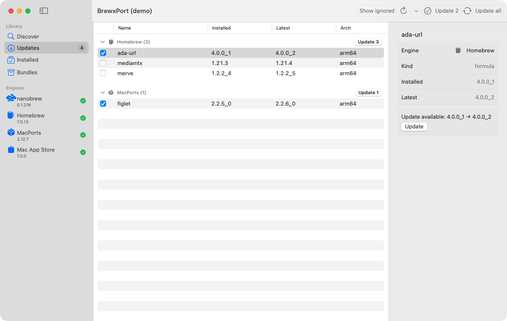

# BrewxPort

A native Mac app for finding, installing and updating software from Homebrew, nanobrew, MacPorts and the Mac App Store, all in one window.

[](https://github.com/rob-paprocki/brewxport/releases/latest)


[](LICENSE)

<picture>
  <source media="(prefers-color-scheme: dark)" srcset="docs/images/updates-dark.png">
  
</picture>

## Why

- Search nanobrew, Homebrew, MacPorts and mas at once. Matching packages sit side by side, and you pick which engine installs it.
- Update everything behind one admin password, like a single UAC prompt on Windows.
- Set up a new Mac from a bundle file exported on the old one, with plain Brewfiles for import and export too. This is coming in a later release.
- Keep Intel Macs going. Homebrew plans to drop Intel in 2027, so MacPorts gets full support here.

**Does not:** replace the engines themselves, or run on Windows or Linux.

## Requirements

| Item | Supported |
|------|-----------|
| macOS | 15 Sequoia or later |
| Hardware | Intel and Apple Silicon |
| Engines | Any of Homebrew, nanobrew, MacPorts, mas |
| Building from source | Swift 6 toolchain (Xcode 16 or later, or the Command Line Tools) |

### What each engine is for

| Engine | What BrewxPort uses it for |
|--------|----------------------------|
| Homebrew | Formulae and casks, and casks whose installers need admin rights |
| nanobrew | Faster installs of Homebrew's own packages on Apple Silicon |
| MacPorts | Ports with variants, and long-term Intel support |
| Mac App Store (`mas`) | Apps you got from the App Store |

## Install

Download `BrewxPort-X.Y.Z.dmg` from the [latest release](https://github.com/rob-paprocki/brewxport/releases/latest), open it and drag BrewxPort onto the Applications folder beside it. The app and the disk image are both signed with a Developer ID and notarized by Apple, so macOS opens them like any other download.

Prefer an installer, or deploying with a tool that expects one? `BrewxPort-X.Y.Z.pkg` puts the same app in Applications. It's signed and notarized as well, and it runs no install scripts: BrewxPort sets up its admin helper itself the first time it starts. There's also `BrewxPort-X.Y.Z.zip`, if you'd rather unzip the app yourself. The downloads go up a few minutes after a release appears, so if the newest one only lists the source files, check back shortly. The source is there as `brewxport-X.Y.Z.tar.gz`, with its checksum in `SHA256SUMS`.

## Quick start

BrewxPort builds with Swift Package Manager and two scripts. There's no Xcode project. Clone the repository and run the tests:

```bash
git clone https://github.com/rob-paprocki/brewxport.git
cd brewxport
swift test
```

Try the window with sample data. Demo mode uses recorded engine output and only simulates installs, upgrades and removals, so no engine command runs:

```bash
scripts/demo.sh
```

Build a signed, universal `BrewxPort.app` into `build/`:

```bash
scripts/build-app.sh --identity "Developer ID Application"
```

Add `--notarize PROFILE` to have Apple notarize it as well. `PROFILE` is a keychain profile you make once with `xcrun notarytool store-credentials`. The script staples the ticket to the app and leaves `BrewxPort-X.Y.Z.zip` next to it. Add `--dmg` as well for the disk image, `BrewxPort-X.Y.Z.dmg`, and `--pkg` for the installer package, `BrewxPort-X.Y.Z.pkg`. Both get signed, notarized and stapled the same way; the package needs a Developer ID Installer certificate.

> [!WARNING]
> A normal launch of `BrewxPort.app` registers its admin helper. Try it in a virtual machine, or use `scripts/demo.sh`.

## Roadmap

Bundles are next. They're the third of the three jobs BrewxPort was built for, after search and updates:

- BrewxPort's own bundle file. Export everything you have installed, from every engine, into one file. Open it on another Mac and you get a preview first: what's in it for each engine, what that Mac already has, and any engine it's missing, with the steps to set that engine up. Then BrewxPort installs the rest behind one password.
- Brewfile import and export. Import reads `brew`, `cask`, `tap` and `mas` lines. Lines BrewxPort doesn't handle, such as Ruby `if` blocks, are kept and shown in the preview. None get dropped. Export writes a plain Brewfile that `brew bundle` reads without BrewxPort.
- A Bundles page in the sidebar, with the same selection and right-click menus as Discover, Updates and Installed.

Before 1.0, BrewxPort also gets tested on a real Intel Mac (so far that's been under Rosetta), Mac App Store updates get checked from start to finish, and it gets tried from a standard, non-admin account. Installing a missing engine for you isn't planned for 1.0.

## Changelog

See [CHANGELOG.md](CHANGELOG.md).

## License

MIT. See [LICENSE](LICENSE).
