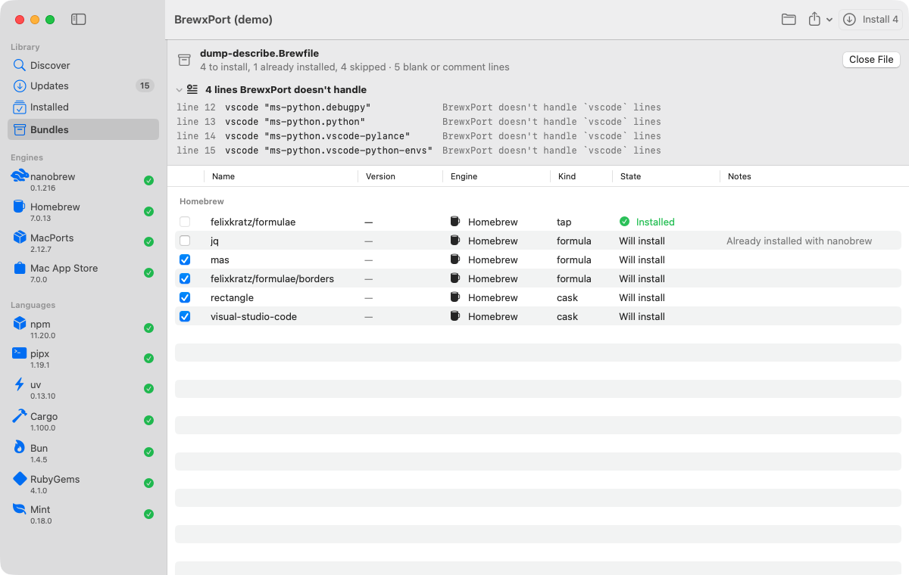

# BrewxPort

A native Mac app for finding, installing and updating software from Homebrew, nanobrew, MacPorts and the Mac App Store, and the command-line tools you install with npm, pipx, uv, Cargo, Bun, RubyGems and Mint, all in one window.

[](https://github.com/rob-paprocki/brewxport/releases/latest)


[](LICENSE)

<picture>
  <source media="(prefers-color-scheme: dark)" srcset="docs/images/updates-dark.png">
  
</picture>

## Why

- Search nanobrew, Homebrew, MacPorts and mas at once. Results are grouped by package manager, and you pick which one installs each package.
- Keep the tools you installed with npm, pipx, uv, Cargo, Bun, RubyGems and Mint up to date in the same lists, without a password.
- Update everything behind one admin password, like a single UAC prompt on Windows.
- Set up a new Mac from a bundle file exported on the old one. Brewfiles work for import and export too.
- Keep Intel Macs going. Homebrew plans to drop Intel in 2027, so MacPorts gets full support here.

**Does not:** replace the engines themselves, or run on Windows or Linux.

## Requirements

| Item | Supported |
|------|-----------|
| macOS | 15 Sequoia or later |
| Hardware | Intel and Apple Silicon |
| Engines | Any of Homebrew, nanobrew, MacPorts, mas |
| Language package managers | Any of npm, pipx, uv, Cargo, Bun 1.4.5 or later, RubyGems, Mint |
| Building from source | Swift 6 toolchain (Xcode 16 or later, or the Command Line Tools) |

### What each engine is for

| Engine | What BrewxPort uses it for |
|--------|----------------------------|
| Homebrew | Formulae and casks, and casks whose installers need admin rights |
| nanobrew | Faster installs of Homebrew's own packages on Apple Silicon |
| MacPorts | Ports with variants, and long-term Intel support |
| Mac App Store (`mas`) | Apps you got from the App Store |
| npm, pipx, uv, Cargo, Bun, RubyGems, Mint | Command-line tools installed for your whole account. See [Language tools](#language-tools) |

## Install

Download `BrewxPort-X.Y.Z.dmg` from the [latest release](https://github.com/rob-paprocki/brewxport/releases/latest), open it and drag BrewxPort onto the Applications folder beside it. The app and the disk image are both signed with a Developer ID and notarized by Apple, so macOS opens them like any other download.

Prefer an installer, or deploying with a tool that expects one? `BrewxPort-X.Y.Z.pkg` puts the same app in Applications. It's signed and notarized as well, and it runs no install scripts: BrewxPort sets up its admin helper itself the first time it starts. There's also `BrewxPort-X.Y.Z.zip`, if you'd rather unzip the app yourself. The downloads go up a few minutes after a release appears, so if the newest one only lists the source files, check back shortly. The source is there as `brewxport-X.Y.Z.tar.gz`, with its checksum in `SHA256SUMS`.

## Set up a package manager

BrewxPort shows a setup screen at launch when none of the four package managers is set up yet. You see it whether you installed from the `.pkg`, the DMG or the zip.

<picture>
  <source media="(prefers-color-scheme: dark)" srcset="docs/images/setup-dark.png">
  
</picture>

The recommended one comes first and the others sit below it. Choose Set Up, or Not now to skip it. If BrewxPort's helper still needs your approval, the screen asks for it in System Settings > General > Login Items and then carries on. Later, the Helper row at the bottom of the sidebar shows whether it's ready.

You can come back later from File > Set Up Package Manager…, from the Set Up button on a missing package manager's Engines page, or from the banner on the Bundles page when a bundle needs one you don't have.

The `.pkg` installer has a checkbox on its Customize step, ticked by default: "Set up Homebrew" on Apple silicon Macs and "Set up MacPorts" on Intel Macs. Ticking it only records your choice. BrewxPort starts that setup the next time it opens, after every `.pkg` install with the box ticked, upgrades included. If the package manager is already there, nothing happens.

| Package manager | Comes from | Checked against |
|-----------------|------------|-----------------|
| Homebrew | The official installer package on GitHub (about 160 MB) | Its published checksum, Apple's notarization and Homebrew's signing team |
| MacPorts | The official installer package on GitHub (about 8 MB) | Its published checksum and Apple's notarization |
| nanobrew | Its release archive | Both published checksums, then `nb init` runs |
| `mas` | Homebrew or MacPorts | Installed with that manager's own install command, so its usual checks apply. Through Homebrew it needs no password; through MacPorts it asks for one |

MacPorts needs Apple's Command Line Tools. If they're missing, BrewxPort installs them first, which is about 1.3 GB.

Each setup needs an administrator account. Homebrew, MacPorts and nanobrew ask for the password once, and `mas` asks only when it goes in through MacPorts. Homebrew isn't offered on Intel Macs because it no longer supports them, and MacPorts is the option there.

BrewxPort only edits a shell file when you click Add to PATH in a Move to preview. The Homebrew and MacPorts installers add themselves to your PATH and nanobrew doesn't. The run log says which happened.

## Quick start

BrewxPort builds with Swift Package Manager and two scripts. There's no Xcode project. Clone the repository and run the tests:

```bash
git clone https://github.com/rob-paprocki/brewxport.git
cd brewxport
swift test
```

Try the window with sample data. Demo mode uses recorded engine output and only simulates installs, upgrades and removals, so no engine command runs:

```bash
scripts/demo.sh
```

Build a signed, universal `BrewxPort.app` into `build/`:

```bash
scripts/build-app.sh --identity "Developer ID Application"
```

Add `--notarize PROFILE` to have Apple notarize it as well. `PROFILE` is a keychain profile you make once with `xcrun notarytool store-credentials`. The script staples the ticket to the app and leaves `BrewxPort-X.Y.Z.zip` next to it. Add `--dmg` as well for the disk image, `BrewxPort-X.Y.Z.dmg`, and `--pkg` for the installer package, `BrewxPort-X.Y.Z.pkg`. Both get signed, notarized and stapled the same way; the package needs a Developer ID Installer certificate.

> [!WARNING]
> A normal launch of `BrewxPort.app` registers its admin helper. Try it in a virtual machine, or use `scripts/demo.sh`.

## Updates, Installed and Discover

These three pages group packages by package manager. Each section shows how many packages it holds and folds up with its arrow. On Updates, a section's Update button, like Update 3 on Homebrew, updates only that manager and asks for at most one password. To see one flat list again, turn off View > Group by Package Manager (⌥⌘G).

When Homebrew updates a package, it also updates the out-of-date packages that depend on it, including ones you've ignored or skipped here. Homebrew does that so they keep working.

## Menu bar and background updates

BrewxPort stays in the menu bar when you close its window, and checks for updates every 12 hours. The icon shows how many updates are waiting. Its menu lists them by package manager, with an Update button for each one, Update All…, Check Now, Refresh MacPorts… and Settings…. A … means the step asks for your password.

The first time you open this version, a short sheet says so and lets you turn on notifications and Open BrewxPort at login. Change any of it later in Settings (⌘,):

| Setting | Choices |
|---------|---------|
| Check for updates | Every hour, Every 4 hours, Every 12 hours (default), Every 24 hours, Never |
| When updates are found | Notify me (default), Update what doesn't need a password, Update everything |
| Show notifications | On (default) or off. Off still updates the badge |
| Open BrewxPort at login | Off by default. It shows up in System Settings > General > Login Items |

The three modes:

- **Notify me** only tells you. Nothing is installed until you choose.
- **Update what doesn't need a password** installs Homebrew formulae, nanobrew packages and language tools by itself. Everything else is left for you, and you get a notification.
- **Update everything** also runs the updates that need a password (MacPorts, Mac App Store apps and Homebrew casks). The ones that don't need a password run at once. The rest wait until you're back at the Mac, then BrewxPort opens with the password sheet. If BrewxPort can't come to the front, you get a notification, "N updates need your password", and clicking it opens the sheet. If you walk away without answering the sheet, it closes and comes back when you return.

Automatic updates leave out a package when updating it would also update one you ignored or skipped. Homebrew and MacPorts bring a package's out-of-date dependencies along when they update it, and Homebrew also updates the out-of-date packages that depend on it. If you ignore or skip an update, an automatic run also leaves out the packages that depend on it and the packages it depends on. Those get their own notification, "N updates need your attention", and stay on Updates for you to run.

If you cancel the password sheet or stop an automatic run, nothing updates by itself until the next scheduled check, password-free updates included. Check Now still checks and notifies. A failed update is tried again at the next check. Scheduled checks and automatic updates wait while the Mac is on battery below 20% or in Low Power Mode. If a check came due while BrewxPort wasn't running, it checks soon after you open it.

MacPorts only learns about new versions when its catalogue is refreshed, and that needs your password. Every MacPorts update run refreshes it first with `port selfupdate`, which may update MacPorts itself. If that step fails, the upgrades are skipped and the run log says why. Until a refresh happens, checks show only what MacPorts already knows about. Refresh MacPorts… does just the refresh, from the menu bar menu or the Updates page.

To turn all of this off, set Settings > Check for updates to Never. BrewxPort then quits when you close its window, as before. With checks on, Quit BrewxPort (stops update checks) really quits.

## Language tools

BrewxPort also looks after the command-line tools you install with seven language package managers. They're listed under Languages in the sidebar, and each one gets its own section on Updates, Installed and Discover, after the four system package managers. Their updates show in the menu bar and run in automatic updates like any other package's.

| Package manager | What BrewxPort lists | Set Up installs |
|-----------------|----------------------|-----------------|
| npm | Packages installed with `npm install -g` | Homebrew's `node`, which includes npm |
| pipx | Apps pipx installed, each in its own environment | `pipx` from Homebrew or MacPorts |
| uv | Tools installed with `uv tool install` | `uv` from Homebrew or MacPorts |
| Cargo | Crates installed with `cargo install` | `rustup` from Homebrew or MacPorts, then Rust's stable toolchain |
| Bun | Packages installed with `bun add -g`, from Bun 1.4.5 on | Homebrew's `bun` |
| RubyGems | Gems that come with commands | Homebrew's `ruby`, which includes RubyGems |
| Mint | Swift command-line tools from GitHub | `mint` from Homebrew or MacPorts |

Discover finds pipx and uv tools by their exact name, because PyPI has no search, and Mint tools by their GitHub `owner/repo`. For some checks, searches and details, BrewxPort asks PyPI, crates.io, RubyGems.org or the npm registry itself, over HTTPS, and it reads Mint tools' versions from their tags on GitHub. Only package names are sent.

### Set Up

A package manager you don't have shows as Not installed. Its page says what Set Up installs, and Set Up installs it through Homebrew like any other formula. On a Mac without Homebrew, pipx, uv, Rust and Mint come from MacPorts instead, which asks for your password once. npm, Bun and RubyGems need Homebrew, because MacPorts keeps Node's and Ruby's tools where only an administrator can change them and takes hours to build Bun. Without Homebrew, their pages say how to install them in your home folder instead.

BrewxPort never downloads and runs an installer script. On an Intel Mac, Homebrew builds Rust, Bun and Mint from source, and the page warns that this takes a while. The setup screen at launch and File > Set Up Package Manager… still cover only the four system package managers.

### No password

Language tools are installed, updated and removed as you, so none of it asks for a password, and Update what doesn't need a password includes them. BrewxPort never runs these package managers as root or through its helper. If your account can't change a package manager's folder, as with macOS's own Ruby or Node from its installer, Install, Update and Uninstall are off for it, and its page says how to fix that. When Homebrew is there without that runtime, the page also offers Set Up Homebrew's Ruby… beside macOS's or MacPorts' Ruby, and Set Up Homebrew's Node… beside an npm you can't change. It doesn't offer Node when that npm is in Homebrew's own folder, as Node's installer puts it on an Intel Mac, because the two would clash.

### Which copy runs, and PATH

If you have two copies of a package manager, such as Homebrew's npm and one from nvm, BrewxPort uses the one your login shell finds first, and its page shows that copy's path and version.

Two package managers can install the same tool, like `fd` from Homebrew's fd and Cargo's fd-find. Installed marks both copies and ticks the one your login shell runs first. It pairs copies by the command they install, or by name, like `ripgrep` from Homebrew and from Cargo. When it can't tell which copy runs, as when both are in one folder, it says so.

If a package manager's folder for tools, such as `~/.cargo/bin`, `~/.local/bin`, `~/.bun/bin` or `~/.mint/bin`, isn't on your PATH, its page says so and offers Add to PATH. It works like the one in Move to. You see the line and the file first, and nothing changes until you click. RubyGems' folder is named but not added, because its name changes with each Ruby minor version. Refresh (⌘R) reads your login shell's PATH again.

### Held updates

Some updates show a pause symbol, with the reason in its tooltip. "Needs Rust 1.96" means the new version needs a newer Rust than you have, so it can't be updated. "Came with Ruby" marks a gem that came with your Ruby, which BrewxPort updates only when you ask. When a registry doesn't answer for some tools, the section says how many it couldn't check, like "2 tools couldn't be checked", and lists the rest as usual.

### Node, Ruby and Python updates

Language tools run on Node, Ruby or Python, and updating those through Homebrew can break them. A new major version of Node needs npm's tools rebuilt, a new minor version of Ruby needs your gems installed again, and a `python@3.x` update can stop the pipx and uv tools made with its old copy. When your tools run on Homebrew's `node`, `ruby` or a `python@3.x`:

- Automatic updates hold that update back, along with any update that would bring it along. You get one notification instead, such as "Ruby 4.1 is ready".
- Updating it yourself shows a warning first.
- Afterwards, the npm, RubyGems, pipx or uv page offers Repair tools. It runs `npm rebuild -g` or `pipx reinstall-all`, or installs each gem or uv tool again. You can run it from those pages at other times, too.
- Uninstalling a `python@3.x` your tools use names the tools that will stop working.
- If Homebrew installed that runtime only because something else needed it, BrewxPort keeps Homebrew from removing it during updates.

### What isn't covered

- A project's own dependencies, such as `package.json`, `Cargo.toml`, `Gemfile` or `Package.swift`. Only tools installed for your whole account are listed.
- Bundles and Brewfiles. Exports leave language tools out and say so in one line, like "Not included: 3 language tools (npm, Cargo)".
- Moving a tool from one language package manager to another.
- Bun older than 1.4.5, which shows as Too old, with how to update it.

## Uninstall a package

Choose Uninstall… from a package's right-click menu or the Package menu, or press Delete on Installed or Updates. BrewxPort works out what goes before anything runs:

- The sheet lists the packages you picked. Libraries that only those packages used are listed under Also remove leftovers from <package manager>, ticked. Untick it and only your picks go. Uninstalling Homebrew's `wget`, for example, offers `openssl@4`, `libidn2` and `libunistring` when nothing else uses them.
- Nothing else is removed. Homebrew normally removes unused libraries on its own after an uninstall; BrewxPort turns that off, so what goes is what the sheet lists.
- nanobrew doesn't record which packages you asked for, so nanobrew uninstalls don't offer leftovers. nanobrew also removes a package even when another one needs it, so BrewxPort checks first and keeps it if something still does.
- If one removal fails, BrewxPort stops removing from that package manager and says what stayed.

## Move a package to another package manager

Right-click a command-line tool on the Installed page, or choose Package > Move to, and pick Homebrew, nanobrew or MacPorts. BrewxPort works out the move and shows it to you before anything runs:

- Packages from the same package manager that need the one you picked move with it. Move Homebrew's `oniguruma` to nanobrew and Homebrew's `jq`, which needs it, goes too.
- If one of them isn't on the other package manager, it stays where it is, and so does the old copy it needs. The preview names each one.
- Libraries that only the moved packages used are listed under Also remove leftovers, ticked. Untick it to keep them.
- If the other package manager's folder isn't on your PATH, the preview says so and offers Add to PATH. It shows the line and the file first, then adds it to `~/.zprofile` (or `~/.bash_profile` for bash) when you click. For other shells, or a setup BrewxPort can't read for sure, you get the line to copy instead. Open a new Terminal window afterwards.

The new copies go in first. BrewxPort then checks that the other package manager lists every one of them, and only then removes the old copies. If an install fails, nothing is removed. Moves between Homebrew and nanobrew don't ask for a password; anything involving MacPorts asks once.

Only command-line tools from Homebrew, nanobrew and MacPorts move. Mac App Store apps, Homebrew apps (casks), formulae from third-party taps and language tools stay put. A package moves only if the other package manager has one with exactly the same name, and you get that package manager's current version.

## Move to another Mac

Open a `.brewxportbundle` or a Brewfile with File > Open Bundle (⌘O), or double-click a bundle in Finder. BrewxPort shows a preview before it touches anything:

<picture>
  <source media="(prefers-color-scheme: dark)" srcset="docs/images/bundles-dark.png">
  
</picture>

- Packages are grouped by engine. Ones this Mac already has are marked. If an engine is missing, the preview lists the steps to set it up.
- Lines BrewxPort doesn't handle, such as `vscode` lines or Ruby `if` blocks, are listed with their line numbers and the reason. Blank and comment lines are counted. None get dropped.
- Third-party taps are flagged and start unticked, unless a package you ticked needs one.
- Tick what you want and install it. It asks for your admin password at most once.

To export, use the Export… menu in the Bundles toolbar, or File > Export Bundle… (⇧⌘E) and File > Export Brewfile… in the menu bar. A `.brewxportbundle` holds everything you have installed from Homebrew, nanobrew, MacPorts and the Mac App Store. Language tools aren't in either kind of file yet, and the export says so in one line, like "Not included: 3 language tools (npm, Cargo)". A Brewfile holds only what `brew bundle` can read, and BrewxPort names whatever it leaves out before it writes the file. To leave out packages that came in only as another package's dependency, turn off Include Dependencies in Exports in either menu; installing the file brings them back. nanobrew is the exception: it doesn't record dependencies, so every nanobrew package is exported.

Files you open are treated as untrusted. Only plain package, tap and App Store lines are read. Lines inside a Ruby block are marked "not handled". BrewxPort can follow simple platform checks like `if OS.mac?`. After any other Ruby code it can't tell what runs next, so every later line is marked "not handled" too. Most options aren't applied, and files over 8 MB or 10,000 entries are refused. Homebrew 7's `trusted: true` on third-party formulae is accepted. Version pins in a bundle are kept but not applied, and installing Mac App Store apps from a bundle hasn't been tested in a virtual machine yet.

## Roadmap

Before 1.0, BrewxPort gets tested on a real Intel Mac (so far that's been under Rosetta), Mac App Store updates get checked from start to finish, and it gets tried from a standard, non-admin account.

## Changelog

See [CHANGELOG.md](CHANGELOG.md).

## License

MIT. See [LICENSE](LICENSE).
