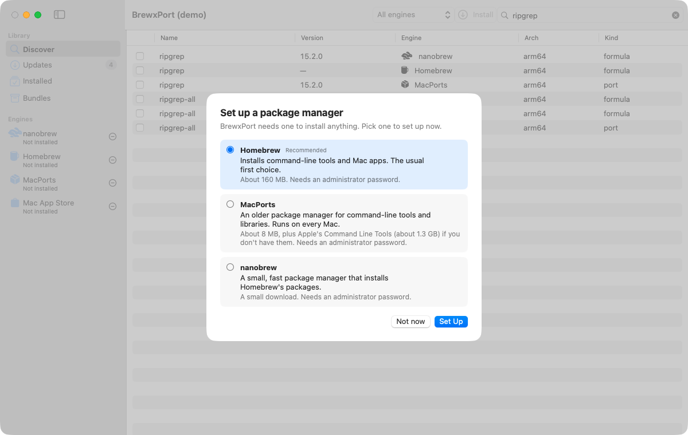

# BrewxPort

A native Mac app for finding, installing and updating software from Homebrew, nanobrew, MacPorts and the Mac App Store, all in one window.

[](https://github.com/rob-paprocki/brewxport/releases/latest)


[](LICENSE)

<picture>
  <source media="(prefers-color-scheme: dark)" srcset="docs/images/updates-dark.png">
  
</picture>

## Why

- Search nanobrew, Homebrew, MacPorts and mas at once. Matching packages sit side by side, and you pick which engine installs it.
- Update everything behind one admin password, like a single UAC prompt on Windows.
- Set up a new Mac from a bundle file exported on the old one. Brewfiles work for import and export too.
- Keep Intel Macs going. Homebrew plans to drop Intel in 2027, so MacPorts gets full support here.

**Does not:** replace the engines themselves, or run on Windows or Linux.

## Requirements

| Item | Supported |
|------|-----------|
| macOS | 15 Sequoia or later |
| Hardware | Intel and Apple Silicon |
| Engines | Any of Homebrew, nanobrew, MacPorts, mas |
| Building from source | Swift 6 toolchain (Xcode 16 or later, or the Command Line Tools) |

### What each engine is for

| Engine | What BrewxPort uses it for |
|--------|----------------------------|
| Homebrew | Formulae and casks, and casks whose installers need admin rights |
| nanobrew | Faster installs of Homebrew's own packages on Apple Silicon |
| MacPorts | Ports with variants, and long-term Intel support |
| Mac App Store (`mas`) | Apps you got from the App Store |

## Install

Download `BrewxPort-X.Y.Z.dmg` from the [latest release](https://github.com/rob-paprocki/brewxport/releases/latest), open it and drag BrewxPort onto the Applications folder beside it. The app and the disk image are both signed with a Developer ID and notarized by Apple, so macOS opens them like any other download.

Prefer an installer, or deploying with a tool that expects one? `BrewxPort-X.Y.Z.pkg` puts the same app in Applications. It's signed and notarized as well, and it runs no install scripts: BrewxPort sets up its admin helper itself the first time it starts. There's also `BrewxPort-X.Y.Z.zip`, if you'd rather unzip the app yourself. The downloads go up a few minutes after a release appears, so if the newest one only lists the source files, check back shortly. The source is there as `brewxport-X.Y.Z.tar.gz`, with its checksum in `SHA256SUMS`.

## Set up a package manager

BrewxPort shows a setup screen at launch when none of the four package managers is set up yet. You see it whether you installed from the `.pkg`, the DMG or the zip.

<picture>
  <source media="(prefers-color-scheme: dark)" srcset="docs/images/setup-dark.png">
  
</picture>

The recommended one comes first and the others sit below it. Choose Set Up, or Not now to skip it. If BrewxPort's helper still needs your approval, the screen asks for it in System Settings > General > Login Items and then carries on. Later, the Helper row at the bottom of the sidebar shows whether it's ready.

You can come back later from File > Set Up Package Manager…, from the Set Up button on a missing package manager's Engines page, or from the banner on the Bundles page when a bundle needs one you don't have.

The `.pkg` installer has a checkbox on its Customize step, ticked by default: "Set up Homebrew" on Apple silicon Macs and "Set up MacPorts" on Intel Macs. Ticking it only records your choice. BrewxPort starts that setup the next time it opens, after every `.pkg` install with the box ticked, upgrades included. If the package manager is already there, nothing happens.

| Package manager | Comes from | Checked against |
|-----------------|------------|-----------------|
| Homebrew | The official installer package on GitHub (about 160 MB) | Its published checksum, Apple's notarization and Homebrew's signing team |
| MacPorts | The official installer package on GitHub (about 8 MB) | Its published checksum and Apple's notarization |
| nanobrew | Its release archive | Both published checksums, then `nb init` runs |
| `mas` | Homebrew or MacPorts | Installed with that manager's own install command, so its usual checks apply. Through Homebrew it needs no password; through MacPorts it asks for one |

MacPorts needs Apple's Command Line Tools. If they're missing, BrewxPort installs them first, which is about 1.3 GB.

Each setup needs an administrator account. Homebrew, MacPorts and nanobrew ask for the password once, and `mas` asks only when it goes in through MacPorts. Homebrew isn't offered on Intel Macs because it no longer supports them, and MacPorts is the option there.

BrewxPort only edits a shell file when you click Add to PATH in a Move to preview. The Homebrew and MacPorts installers add themselves to your PATH and nanobrew doesn't. The run log says which happened.

## Quick start

BrewxPort builds with Swift Package Manager and two scripts. There's no Xcode project. Clone the repository and run the tests:

```bash
git clone https://github.com/rob-paprocki/brewxport.git
cd brewxport
swift test
```

Try the window with sample data. Demo mode uses recorded engine output and only simulates installs, upgrades and removals, so no engine command runs:

```bash
scripts/demo.sh
```

Build a signed, universal `BrewxPort.app` into `build/`:

```bash
scripts/build-app.sh --identity "Developer ID Application"
```

Add `--notarize PROFILE` to have Apple notarize it as well. `PROFILE` is a keychain profile you make once with `xcrun notarytool store-credentials`. The script staples the ticket to the app and leaves `BrewxPort-X.Y.Z.zip` next to it. Add `--dmg` as well for the disk image, `BrewxPort-X.Y.Z.dmg`, and `--pkg` for the installer package, `BrewxPort-X.Y.Z.pkg`. Both get signed, notarized and stapled the same way; the package needs a Developer ID Installer certificate.

> [!WARNING]
> A normal launch of `BrewxPort.app` registers its admin helper. Try it in a virtual machine, or use `scripts/demo.sh`.

## Uninstall a package

Choose Uninstall… from a package's right-click menu or the Package menu, or press Delete on Installed or Updates. BrewxPort works out what goes before anything runs:

- The sheet lists the packages you picked. Libraries that only those packages used are listed under Also remove leftovers from <package manager>, ticked. Untick it and only your picks go. Uninstalling Homebrew's `wget`, for example, offers `openssl@4`, `libidn2` and `libunistring` when nothing else uses them.
- Nothing else is removed. Homebrew normally removes unused libraries on its own after an uninstall; BrewxPort turns that off, so what goes is what the sheet lists.
- nanobrew doesn't record which packages you asked for, so nanobrew uninstalls don't offer leftovers. nanobrew also removes a package even when another one needs it, so BrewxPort checks first and keeps it if something still does.
- If one removal fails, BrewxPort stops removing from that package manager and says what stayed.

## Move a package to another package manager

Right-click a command-line tool on the Installed page, or choose Package > Move to, and pick Homebrew, nanobrew or MacPorts. BrewxPort works out the move and shows it to you before anything runs:

- Packages from the same package manager that need the one you picked move with it. Move Homebrew's `oniguruma` to nanobrew and Homebrew's `jq`, which needs it, goes too.
- If one of them isn't on the other package manager, it stays where it is, and so does the old copy it needs. The preview names each one.
- Libraries that only the moved packages used are listed under Also remove leftovers, ticked. Untick it to keep them.
- If the other package manager's folder isn't on your PATH, the preview says so and offers Add to PATH. It shows the line and the file first, then adds it to `~/.zprofile` (or `~/.bash_profile` for bash) when you click. For other shells, or a setup BrewxPort can't read for sure, you get the line to copy instead. Open a new Terminal window afterwards.

The new copies go in first. BrewxPort then checks that the other package manager lists every one of them, and only then removes the old copies. If an install fails, nothing is removed. Moves between Homebrew and nanobrew don't ask for a password; anything involving MacPorts asks once.

Only command-line tools move. Mac App Store apps, Homebrew apps (casks) and formulae from third-party taps stay put. A package moves only if the other package manager has one with exactly the same name, and you get that package manager's current version.

## Move to another Mac

Open a `.brewxportbundle` or a Brewfile with File > Open Bundle (⌘O), or double-click a bundle in Finder. BrewxPort shows a preview before it touches anything:

<picture>
  <source media="(prefers-color-scheme: dark)" srcset="docs/images/bundles-dark.png">
  
</picture>

- Packages are grouped by engine. Ones this Mac already has are marked. If an engine is missing, the preview lists the steps to set it up.
- Lines BrewxPort doesn't handle, such as `vscode` lines or Ruby `if` blocks, are listed with their line numbers and the reason. Blank and comment lines are counted. None get dropped.
- Third-party taps are flagged and start unticked, unless a package you ticked needs one.
- Tick what you want and install it. It asks for your admin password at most once.

To export, use the Export… menu in the Bundles toolbar, or File > Export Bundle… (⇧⌘E) and File > Export Brewfile… in the menu bar. A `.brewxportbundle` holds everything you have installed, from every engine. A Brewfile holds only what `brew bundle` can read, and BrewxPort names whatever it leaves out before it writes the file. To leave out packages that came in only as another package's dependency, turn off Include Dependencies in Exports in either menu; installing the file brings them back. nanobrew is the exception: it doesn't record dependencies, so every nanobrew package is exported.

Files you open are treated as untrusted. Only plain package, tap and App Store lines are read. Lines inside a Ruby block are marked "not handled". BrewxPort can follow simple platform checks like `if OS.mac?`. After any other Ruby code it can't tell what runs next, so every later line is marked "not handled" too. Most options aren't applied, and files over 8 MB or 10,000 entries are refused. Homebrew 7's `trusted: true` on third-party formulae is accepted. Version pins in a bundle are kept but not applied, and installing Mac App Store apps from a bundle hasn't been tested in a virtual machine yet.

## Roadmap

Before 1.0, BrewxPort gets tested on a real Intel Mac (so far that's been under Rosetta), Mac App Store updates get checked from start to finish, and it gets tried from a standard, non-admin account.

## Changelog

See [CHANGELOG.md](CHANGELOG.md).

## License

MIT. See [LICENSE](LICENSE).
